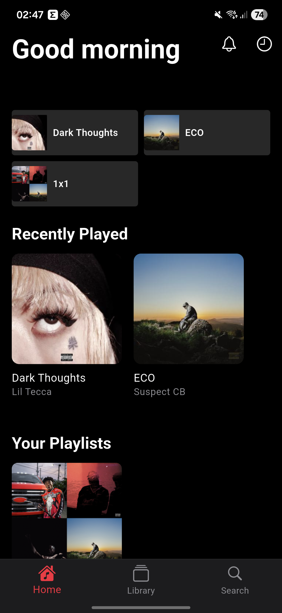
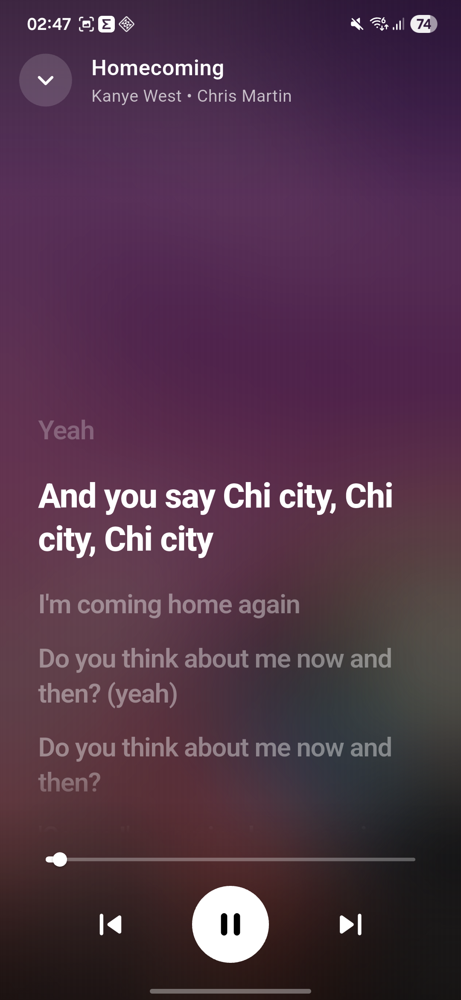
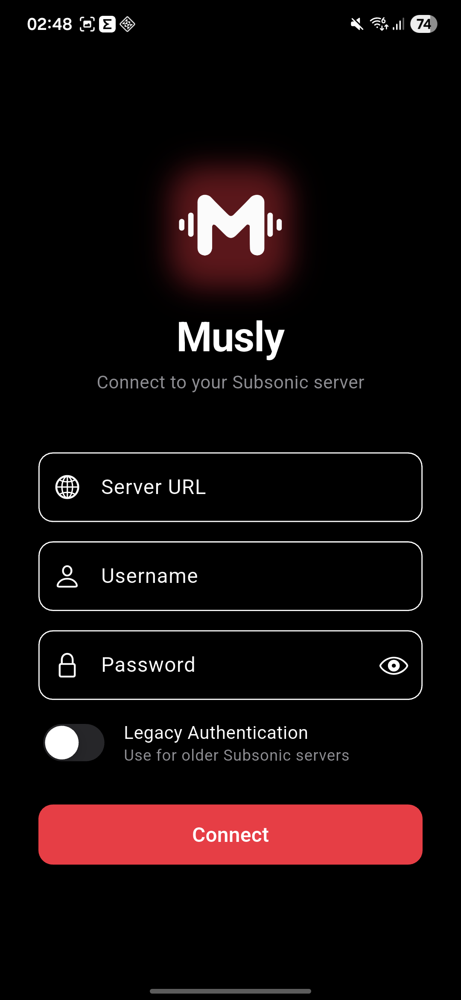

# Musly

A free, cross-platform music player and streaming client for self-hosted libraries, web streams, and local audio files.

[Website](https://musly.devid.lol) · [Releases & Downloads](https://github.com/dddevid/Musly/releases) · [Discord Community](https://discord.gg/k9FqpbT65M) · [Crowdin Translations](https://crowdin.com/project/musly)

---

<p align="center">
  
  
  
  
</p>

---

## GitAds Sponsored
[](https://gitads.dev/v1/ad-track?source=dddevid/musly@github)

## Supported Music Sources & Servers

Musly connects to a wide variety of music sources in a single client:

- **Web Stream**: Direct music search and on-demand streaming from open web sources. No server, user account, or login required, search for songs, discover tracks, create local playlists, cache audio locally, and get time-synced lyrics automatically.
- **Navidrome**: Full Subsonic API support for browsing albums, artists, playlists, genres, and favorites.
- **Jellyfin & Emby**: Direct API connection with user authentication and media library browsing.
- **Subsonic / Airsonic / Gonic**: Standard Subsonic API compatible servers.
- **Internet Radio**: Directory of thousands of live internet radio stations worldwide powered by Radio Browser, plus custom stream URLs.
- **Local Audio Files**: Direct device storage playback supporting MP3, FLAC, AAC, WAV, OGG, OPUS, and M4A.

---

## Supported Platforms

Musly is built with Flutter and runs natively across desktop, mobile, and TV:

- **Linux**: Available across all major distribution ecosystems:
  - `.deb` (Debian, Ubuntu, Linux Mint)
  - `.rpm` (Fedora, RHEL, openSUSE)
  - `.pkg.tar.zst` (Arch Linux, Manjaro)
  - `.AppImage` (Universal standalone executable for any distribution)
  - `.flatpak` (Flatpak standalone bundle)
  - `.snap` (Snap package)
  - `.tar.gz` (Portable standalone archive)
- **Windows**: Windows 10/11 setup installer (`musly-setup.exe`) and portable standalone archive (`musly-windows.zip`).
- **macOS**: Drag-and-drop installer (`musly-macos.dmg`) for Apple Silicon and Intel Macs.
- **iOS**: Sideloadable IPA (`musly-ios.ipa` via AltStore, Sideloadly, or similar), supporting iOS 15.0 and newer.
- **Android**: Universal APK (`app-release.apk`) supporting phones, tablets, foldables, and Android Auto integration.
- **Tizen**: Native Smart TV package (`.tpk`) for Samsung TVs (Tizen 4.0+ / 2018 or newer).
- **Web**: Progressive web client.

Download the latest version for your platform from [GitHub Releases](https://github.com/dddevid/Musly/releases/latest).

---

## Features

### Audio & Playback
- Gapless playback and ReplayGain loudness normalization.
- Smart radio queues with auto-refill based on your favorite tracks and artists.
- Sleep timer, custom playback speeds, and loop/repeat modes.
- Media session integration (system media controls, lock screen player, headphone buttons).

### Synchronized Lyrics
- Time-synced lyrics with interactive tap-to-seek.
- Desktop fullscreen lyrics view with smooth auto-scroll.
- Automatic screen wake lock control while lyrics are open.

### Desktop Experience
- Dedicated desktop layout with persistent sidebar and collapsible navigation.
- Desktop player bar with direct playlist navigation and track options.
- Spotverlay desktop overlay integration.
- System tray and media key support (SMTC on Windows, MPRIS on Linux).

### Offline & Portability
- Download individual tracks, entire albums, and playlists for offline playback.
- Local playlist management independent of remote servers.
- Granular cache controls and storage management.

### Casting & Remote Control
- Cast audio to UPnP, DLNA, and network cast devices directly from the app.

### Customization & Stats
- Material 3 Dynamic Colors (Material You) that adapt to album artwork or system accents.
- Light, dark, and true OLED black themes.
- Musly Wrapped: in-app listening statistics, top genres, and yearly rewind summaries.

---

## Getting Started

1. Download Musly for your operating system from the [Releases page](https://github.com/dddevid/Musly/releases/latest).
2. Launch the app and pick your music source:
   - **Self-Hosted Server** (Navidrome, Subsonic, Jellyfin, Emby): enter your server URL, username, and password.
   - **Web Stream**: start searching and streaming immediately with zero setup.
   - **Local Storage**: select your music folder to index audio files.
   - **Internet Radio**: explore live stations by genre or country.
3. Tap **Connect** and start listening.

---

## Building from Source

### Setup
```bash
git clone https://github.com/dddevid/Musly.git
cd Musly
flutter pub get
flutter run
```

---

## Translations

Musly is translated into 27 languages thanks to community contributors on Crowdin:

- [Contribute Translations on Crowdin](https://crowdin.com/project/musly)
- See [TRANSLATIONS.md](TRANSLATIONS.md) for contribution guidelines.

---

## Community

Have questions, feedback, or ideas?
- Join the [Musly Discord](https://discord.gg/k9FqpbT65M) community.
- Report bugs or submit feature requests on [GitHub Issues](https://github.com/dddevid/Musly/issues).

---

## License

This project is open source and distributed under the **Creative Commons Attribution-NonCommercial-ShareAlike 4.0 International (CC BY-NC-SA 4.0)** License. See [LICENSE](LICENSE) for details.

> [!IMPORTANT]
> Do not redistribute or publish this app to commercial application stores.

---

<div align="center">
  <sub>Made with ❤️ in Italy by an Albanian developer</sub>
</div>
